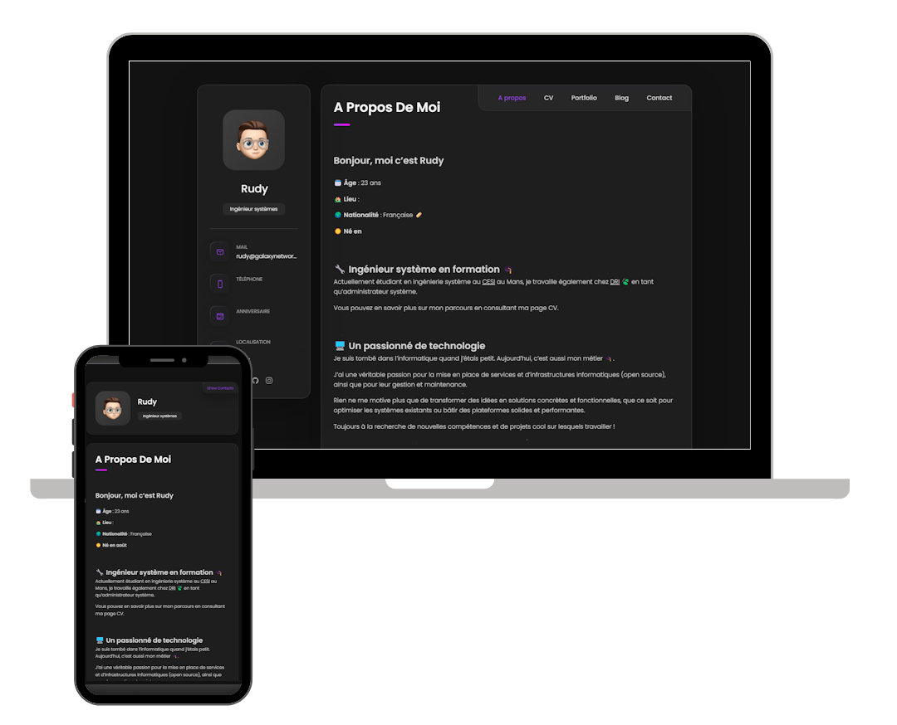

<h2 align="center">
  Portfolio Personal
  <br/>
  <a href="https://rudze.github.io/WEB-Portfolio-Personal-main/" target="_blank">rudze.github.io/WEB-Portfolio-Personal-main</a>
</h2>

---

<div align="center">
  
</div>

<br/>

<div align="center">

[](https://forthebadge.com) &nbsp;
[](https://forthebadge.com) &nbsp;
[](https://forthebadge.com) &nbsp;
[](https://forthebadge.com) &nbsp;
[](https://forthebadge.com) &nbsp;
</div>

---

## About the Project

**Portfolio Personal** is my personal website as a **Linux systems engineer**: who I am, my experience, my technical skills and the projects I build in my spare time.

It is a **lightweight static website** (HTML, CSS and vanilla JavaScript), with no framework and no build step, so it can be hosted anywhere, including **GitHub Pages**.

➡️ **Live demo:** [https://rudze.github.io/WEB-Portfolio-Personal-main/](https://rudze.github.io/WEB-Portfolio-Personal-main/)

---

## Features

* ✅ **About, Resume and Portfolio** sections in a single page
* ✅ **English / French** translation with a flag switch (choice is remembered)
* ✅ **Interactive skills terminal**: folders, typed `ls` commands and animated output
* ✅ **GitHub contributions graph**, loaded live from my public profile
* ✅ **Project detail modal** with description, highlights, tech stack and links
* ✅ **Project filters** by category (applications, websites, games)
* ✅ **Animated background** reacting to the mouse
* ✅ **Responsive design** for desktop, tablet and mobile
* ✅ Respects the **reduced motion** accessibility setting

---

## Project Structure

```
WEB-Portfolio-Personal-main/
├── index.html              # Page content (English source text)
├── assets/
│   ├── css/
│   │   └── style.css       # Theme, layout and animations
│   ├── js/
│   │   ├── i18n.js         # Language switch + French translations
│   │   └── script.js       # Navigation, skills terminal, GitHub graph, project modal
│   └── images/             # Avatars and project covers
└── assets_readme/          # Images used in this README
```

---

## Installation

To install **Portfolio Personal**, clone the repository:

### Linux & macOS

```bash
git clone https://github.com/Rudze/WEB-Portfolio-Personal-main.git
cd WEB-Portfolio-Personal-main
```

### Windows

```bash
git clone https://github.com/Rudze/WEB-Portfolio-Personal-main.git
cd WEB-Portfolio-Personal-main
```

Then simply open `index.html` in your browser. No dependencies to install.

---

## Deployment

The website is hosted with **GitHub Pages**:

1. Go to **Settings → Pages** in the repository
2. Select **Deploy from a branch**, branch `main`, folder `/ (root)`
3. Every push to `main` updates the live website automatically

---

## Customization

* **Texts**: edit the English text in `index.html` and its French version in `assets/js/i18n.js` (same `data-i18n` key)
* **Projects**: duplicate a `project-item` block in `index.html` and fill in its hidden `project-details`
* **Skills**: edit the `SKILLS` list at the top of the skills terminal section in `assets/js/script.js`
* **GitHub graph**: change the `data-gh-user` attribute to display another account

---

## Versioning

Releases are fully automated with [semantic-release](https://github.com/semantic-release/semantic-release).
On every push to `main`, a GitHub Action reads the commit messages and publishes a new version, a git tag, a GitHub release and an updated [CHANGELOG.md](CHANGELOG.md).

Commits follow the [Conventional Commits](https://www.conventionalcommits.org/) format:

| Commit | Release |
| --- | --- |
| `fix: ...` | Patch (`1.0.0` → `1.0.1`) |
| `feat: ...` | Minor (`1.0.0` → `1.1.0`) |
| `feat!: ...` or `BREAKING CHANGE:` | Major (`1.0.0` → `2.0.0`) |
| `docs:`, `style:`, `chore:`, `ci:`... | No release |

---

## Credit

Special thanks to [codewithsadee](https://github.com/codewithsadee) for creating the original [vCard Personal Portfolio](https://github.com/codewithsadee/vcard-personal-portfolio), which this website is based on.

---

## Contact

If you have any questions, feel free to reach out at contact@rudydavid.fr

---

### Show Your Support

Give a ⭐ if you like this website!
